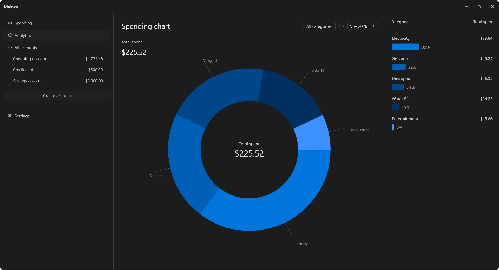
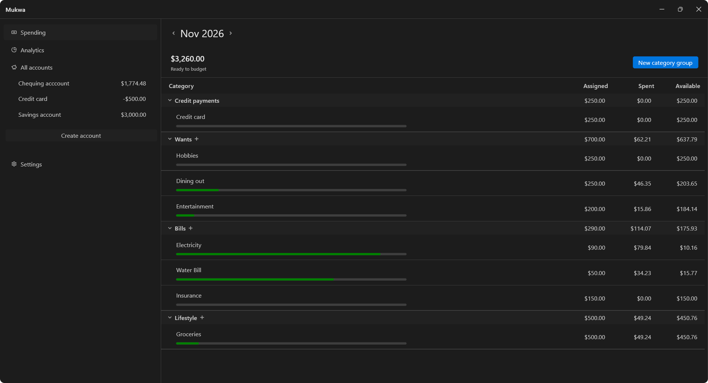
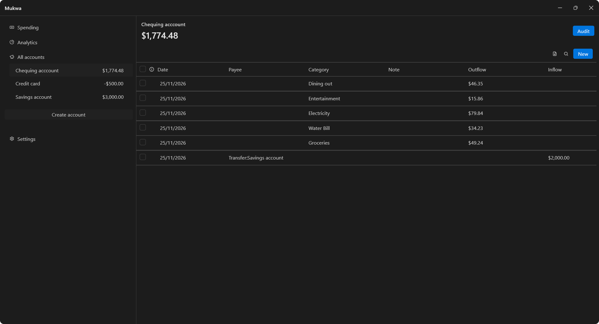

<h1 align="center">
  
  <br>
  <span>Mukwa</span>
</h1>
<p align="center">
    <a href="https://mukwa.wakunguma.com">Website</a> |
    <a href="https://mukwa.wakunguma.com/docs/getting-started">Docs</a> |
    <a href="https://github.com/mukwa-app/mukwa/blob/main/CONTRIBUTING.md">Contributing</a>
</p>


Mukwa is an open source, local-first personal finance app. All data is stored on your device, no cloud and no accounts. It is written in Rust and built using Slint.





## Installation

<h3>
  
  <span>Windows</span>
</h3>

Download the installer for [Intel/AMD](https://github.com/snubwoody/mukwa/releases/latest/download/Mukwa-x86_64-Setup.exe) or [ARM64](https://github.com/snubwoody/mukwa/releases/latest/download/Mukwa-aarch64-Setup.exe).

Or install via [Winget](https://winstall.app/apps/Wakunguma.Mukwa).

```powershell
winget install -e --id Wakunguma.Mukwa
```

<h3>
  
  <span>Linux</span>
</h3>

Download the [AppImage](https://github.com/snubwoody/mukwa/releases/latest/download/Mukwa-x86_64.AppImage), [Deb](https://github.com/snubwoody/mukwa/releases/latest/download/Mukwa-x86_64.deb) or [tarball](https://github.com/snubwoody/mukwa/releases/latest/download/mukwa-x86_64.tar.gz).

## Contributing

If you have any ideas, issues, etc. regarding Mukwa, or would like to contribute to Mukwa through pull requests, please check out the ["Contributing"](./CONTRIBUTING.md) document.

## License

Mukwa is licensed under the [GPL V3](https://www.gnu.org/licenses/gpl-3.0.en.html) license, see the [LICENSE](./LICENSE)
file for details.
